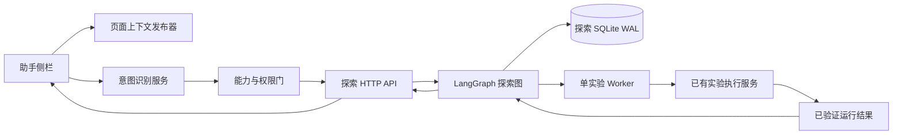

# Agent 助手自动探索实验改造方案（2026-10-31）

## 0. 文档定位

本文是 Agent 助手自动探索实验的落地设计，不代表功能已经完成。实现前后必须以 `docs/AI_HANDOFF.md` 的当前事实为准。

本方案只覆盖电脑网页端的 Agent 助手、Bridge 和本地实验编排；不扩展移动端，不修改 `D:\tileSim`，不改变真实 Provider 凭据，不把本地 synthetic 结果描述成生产验收。

当前工作树包含未提交的自动探索契约改动。开发 Agent 必须保留这些改动，不执行 reset、clean、commit、push 或部署。

## 1. 当前事实与改造目标

### 1.1 当前已经存在的能力

当前请求链路是：

```text
用户输入
  -> 读取当前页面上下文
  -> 检查上下文版本、运行身份、Bridge 身份和契约版本
  -> POST /api/agent/intent
  -> 模型返回受限任务类型
  -> 前端确定性判断页面能力和证据状态
  -> 解释、分析、报告、配置草案或导航建议
```

主要入口：

- 前端请求入口：`src/App.vue` 的 `submitAgentInstruction`；
- 意图请求构造：`src/App.vue` 的 `publishedAgentIntentRequest`；
- 意图 Provider：`bridge/providers/agent_intent.py`；
- 当前流程适配器：`bridge/services/agent_flow.py`；
- 当前流程状态机：`bridge/services/agent_orchestrator.py`；
- 优化和批处理查询：`src/features/agent-harness/optimization-queries.ts`、`batch-queries.ts`；
- 助手侧栏：`src/features/agent-copilot-shell/AgentCopilotShell.vue`。

### 1.2 当前缺口

1. 正式意图枚举没有 `explore_experiment`。
2. `bridge/agent_harness/exploration.py` 只有自动探索 v2 的确定性契约和状态转移，没有 HTTP 路由、Worker 或真实执行适配器。
3. `App.vue` 查询了旧的优化和批处理数据，但 `AgentCopilotShell.vue` 只渲染 `AgentTypedBlockList`，没有渲染优化面板、批处理面板或自动探索面板。
4. 没有“允许助手自动探索”授权卡，也没有授权后自动开始的前端控制链路。
5. 标准 Bridge 仍使用 `deterministic_transition_adapter`；LangGraph 目前是可选本地适配器，不是正式 HTTP runtime。
6. 当前一次只能执行一个实验；这条限制必须成为后端不变量，而不是只在界面上显示。
7. Run Intake v2、真实 Provider acceptance 和生产执行仍未接通，不能在本次实现中被假设为已存在。

### 1.3 改造完成后的目标

用户输入“帮我探索更好的实验配置”后，目标链路为：

```text
识别自动探索意图
  -> 检查页面上下文、权限、参数面和运行时能力
  -> 必要时自动跳转到已授权页面
  -> 显示授权摘要
  -> 用户点击一次“允许助手自动探索”
  -> LangGraph 持久化循环
       生成候选
       -> 校验候选
       -> 创建一个实验
       -> 等待实验终态
       -> 读取已验证指标
       -> 比较当前最佳方案
       -> 判断是否继续
  -> 达到轮次、实验次数、时间或无改进上限
  -> 显示最佳方案和停止原因
```

授权后不再要求用户逐个批准候选、点击页面或手动切换页面。用户只保留“暂停”“继续”“停止”三个控制入口；暂停、恢复和停止都由后端持久化状态决定。

## 2. 外部成熟方案调研与取舍

### 2.1 LangGraph：采用为编排运行时

LangGraph 的核心做法是把 Agent 表达为有状态图，用节点处理状态，用检查点保存每次转换，并通过 interrupt/resume 实现人工介入。官方资料：

- [Durable execution](https://docs.langchain.com/oss/python/langgraph/durable-execution)
- [Interrupts / human-in-the-loop](https://docs.langchain.com/oss/python/langgraph/human-in-the-loop)

本项目采用：

- `StateGraph` 表达探索节点；
- SQLite WAL 检查点保存本地开发状态；
- 授权、暂停、恢复和上下文失效使用可恢复状态，而不是进程内布尔变量；
- 节点只返回状态增量，不直接操作 Vue、路由或 SQLite 表。

不采用：

- 让 LangGraph 直接拥有运行工件；
- 让模型节点直接调用任意 URL 或 subprocess；
- 用图框架替代已有的契约校验和执行服务。

### 2.2 OpenAI Agents SDK：借鉴 Runner、工具和人工介入边界，不作为核心依赖

OpenAI Agents SDK 的公开设计强调 Agent、工具、运行器、会话、追踪和人工介入边界。参考：[OpenAI Agents SDK](https://openai.github.io/openai-agents-python/)。

本项目借鉴三点：

1. 模型只负责提出结构化候选，工具调用由宿主程序执行；
2. 每次运行都携带会话和上下文身份；
3. 人工授权是显式动作，不能由模型自行完成。

不直接引入 SDK，因为当前 Bridge 是标准库 Python 服务，已有契约、SQLite 和执行层；引入第二套 Agent runtime 会造成状态和工具注册重复。

### 2.3 AutoGen：借鉴终止条件和单并发团队约束

AutoGen 的 AgentChat 使用显式终止条件控制多轮会话，避免循环无限运行。参考：[AutoGen termination conditions](https://microsoft.github.io/autogen/stable/user-guide/agentchat-user-guide/tutorial/termination.html)。

本项目将终止条件写进探索预算：最大轮次、最大实验数、最大模型调用数、最大工具调用数、最大失败数、最大无改进轮数和最大执行时间。每次只有一个运行槽位，因此不采用多 Agent 并行团队。

### 2.4 CrewAI Flows：借鉴事件驱动和流程状态隔离，不采用其运行时

CrewAI Flows 将流程状态、事件触发和步骤编排分开。参考：[CrewAI Flows](https://docs.crewai.com/en/concepts/flows)。

本项目保留类似的边界：探索会话、事件和实验运行分开存储；前端可以通过事件回放观察状态。由于当前 Bridge 已有自己的契约和事件仓库，不再引入 CrewAI。

### 2.5 Temporal：作为后续生产化参考，不列入本批次依赖

Temporal 的 Workflow/Activity 模式适合长时间运行、重试和进程恢复，但需要独立服务和部署拓扑。本地网页端当前只有单 Bridge 和单实验槽位，先用 LangGraph + SQLite WAL；如果以后需要跨机器、高可用和多 Worker，再评估 Temporal，而不是现在提前引入基础设施。

## 3. 总体目标架构



### 3.1 前端分层

| 层 | 组件 | 责任 |
|---|---|---|
| 页面编排 | `App.vue` | 连接当前页面上下文、意图分支、路由锁和面板事件；不实现探索状态机 |
| Agent feature | `src/features/agent-exploration/` | 探索 API、TanStack Query、授权卡、进度面板、页面锁状态 |
| 侧栏壳 | `AgentCopilotShell.vue` | 渲染对话、授权卡和探索面板；转发事件 |
| 页面状态 | Pinia | 保存当前探索锁、活动会话和本地 UI 状态 |
| 服务端状态 | TanStack Query | 查询探索会话、事件、当前最佳方案和终态 |
| 合同 | `src/contracts/generated/` | 由 Bridge Schema 生成，不手写重复 DTO |

### 3.2 Bridge 分层

```text
api/routes_agent_exploration.py
  -> contracts/exploration.py
  -> services/exploration_service.py
  -> services/exploration_worker.py
  -> services/run_executor.py
  -> repositories/explorations.py
  -> infra/SQLite WAL / 当前执行服务
```

`server.py` 只负责路径分派、请求读取、错误转换和服务组装；不把整个循环写进 `server.py` 或一个巨型函数。

## 4. 页面上下文、权限和授权模型

### 4.1 进入自动探索的前置条件

探索服务只接受已发布页面目录中的页面身份，不接受模型生成 URL。启动前必须同时满足：

1. 当前页面上下文已发布且上下文版本号存在；
2. Bridge 身份和契约版本可用；
3. 当前页面有实验配置能力，能够读取参数目录和当前配置；
4. 当前运行环境发布了“创建实验”“读取已验证结果”的能力；
5. 用户当前会话具备自动探索授权范围；
6. 当前没有其他探索会话占用唯一运行槽位。

如果用户在结果页或概览页发起请求，助手可以在拥有导航授权时自动跳转到实验配置页；没有导航授权时直接提示用户跳转。上下文不足时使用中文提示：

> 当前页面上下文不足，请打开一次实验运行或跳转到运行结果页面后重试。

没有权限时使用中文提示：

> 当前页面没有执行自动探索所需的权限。

### 4.2 权限与授权的区别

- 权限：Bridge 根据当前会话和能力目录判断“能不能做”。
- 授权：用户在前端点击按钮后，对本次探索授予固定范围和固定预算。

授权信封至少包含：

```text
授权编号
授权摘要
页面白名单
动作白名单
参数白名单
最大轮次
最大实验数
最大模型调用数
最大工具调用数
最大执行时间
并发数 = 1
上下文版本
运行身份
后端身份
契约版本
授权摘要哈希
```

授权创建后，页面白名单、动作白名单、参数范围和预算不可扩大。需要改变授权时先暂停，使用新的授权编号重新授权。

### 4.3 页面锁定

页面锁定是上下文一致性机制，不是安全系统。锁定期间：

- 实验配置页的参数编辑控件进入只读；
- 当前运行身份不可切换；
- 未授权页面跳转被路由守卫阻止；
- 自动导航只使用发布目录中的页面编号；
- 用户点击停止后解除锁定；
- 如果浏览器仍发生了页面变化，Bridge 在下一次节点转换重新核对上下文摘要，状态进入 `context_expired`。

前端锁定不能替代后端检查。后端每次生成候选、创建运行和读取结果前都重新比较上下文版本、运行身份、参数目录摘要和授权摘要。

## 5. 意图识别设计

### 5.1 新增任务类型

将 `explore_experiment` 加入正式意图枚举。模型输出只包含：

- 任务类型；
- 用户目标；
- 目标指标路径；
- 优化方向；
- 用户明确要求的轮次数；
- 所需页面能力；
- 候选页面；
- 需要澄清的问题。

模型不能输出授权编号、运行编号、URL、任意工具名或直接执行动作。

### 5.2 意图后的确定性分支

前端收到 `explore_experiment` 后调用 `deriveExplorationPreflight()`，只做页面和能力判断，不生成候选、不创建实验。分支顺序：

1. 上下文版本不匹配：停止并提示刷新上下文；
2. 当前页面能力不足：检查是否存在已授权目标页面；
3. 没有导航权限：提示用户手动跳转；
4. 没有实验执行权限：显示无权限提示；
5. 已有活动探索：显示当前探索进度；
6. 条件满足：生成授权卡。

## 6. 自动探索状态机

### 6.1 状态

```text
waiting_authorization
  -> validating_context
  -> generating_candidate
  -> validating_candidate
  -> creating_run
  -> waiting_run
  -> evaluating_result
  -> comparing_best
  -> deciding_continue
  -> generating_candidate  （继续）
  -> completed              （达到目标或预算）
```

可从运行中进入：

- `paused`：用户暂停；
- `cancelled`：用户停止；
- `context_expired`：页面或运行身份变化；
- `parameter_validation_failed`：候选不符合参数契约；
- `run_failed`：实验已明确失败；
- `recovery_required`：结果未知，不能自动重提；
- `manual_intervention_required`：需要人工处理。

### 6.2 LangGraph 节点

节点保持单一职责：

1. `receive_request`：接收已验证的探索请求；
2. `validate_context`：核对页面、运行、契约和授权身份；
3. `generate_candidate`：调用模型生成一个候选配置；
4. `validate_candidate`：调用正式参数校验器；
5. `create_single_run`：通过 `RunExecutor` 创建一个实验；
6. `wait_run`：等待唯一实验槽位完成；
7. `evaluate_result`：读取已验证指标和证据引用；
8. `compare_best`：按目标方向比较当前最佳方案；
9. `decide_continue`：应用预算和停止策略；
10. `pause_or_resume`：处理用户控制；
11. `complete`：生成摘要、停止原因和最终事件。

图节点不直接访问 Vue，不直接拼接路由，不直接写运行目录，不直接调用 Provider subprocess。

### 6.3 预算

默认预算：

| 项目 | 默认值 | 说明 |
|---|---:|---|
| 最大轮次 | 10 | 一轮对应一个候选和一个实验 |
| 最大实验数 | 10 | 与轮次同时受限 |
| 最大并发数 | 1 | 固定，不允许前端修改 |
| 最大连续无改进轮数 | 3 | 达到后停止 |
| 最大失败数 | 2 | 达到后停止 |
| 最大模型调用数 | 24 | 候选生成和必要的解释调用共用 |
| 每轮最大工具调用数 | 4 | 防止单轮失控 |
| 最大执行时间 | 15 分钟 | 由 Bridge 根据持久化创建时间计算 |

用户明确要求更高轮次时，前端把解析出的数字交给 Bridge；Bridge 只接受本地开发上限内的值。默认值不由模型或前端自行放宽。

### 6.4 一次只能执行一个实验

执行层使用一个明确的运行槽位：

- Worker 只有一个消费循环；
- 数据库保存 `active_run_id` 和槽位租约；
- 创建运行前先占用槽位；
- 运行终态或明确失败后释放槽位；
- 第二个探索会话收到 `exploration_busy`；
- 不使用线程池并行提交候选；
- 不把“批处理候选列表”误认为并发执行。

这条规则同时在服务层、数据库约束和测试中体现。

## 7. 候选生成与实验执行

### 7.1 候选生成

模型输入：当前参数目录、当前配置、目标指标、方向、已尝试候选摘要、预算剩余量和已验证最佳指标。

模型输出：一个闭世界候选对象，包含候选编号、参数修改集合、候选摘要和目标依据。模型不能输出完整运行命令、路径、凭据或未发布参数。

候选生成后立即通过现有正式参数校验器；校验失败只记录该轮失败并按失败预算决定停止，不把非法候选偷偷修正成另一个候选。

### 7.2 `RunExecutor` 接口

定义独立接口：

```text
create_run(candidate, authorization) -> run identity
wait_for_terminal(run identity) -> terminal run state
read_verified_metrics(run identity) -> verified evaluation
cancel(run identity) -> terminal run state
```

第一阶段实现 `LocalSyntheticRunExecutor`，复用当前 Bridge 已有执行服务和 synthetic trace；第二阶段接入正式 Run Intake v2；Worker 和 LangGraph 不感知具体 CLI、文件路径或 Provider。

### 7.3 未知结果

- 明确失败：记录失败原因，可按预算停止；
- 明确成功：读取已验证结果；
- 超时但执行状态可确认：进入失败或已定义的终态；
- 无法确认是否创建成功：进入 `recovery_required`，不得盲目创建第二个相同实验。

已知可重试错误使用同一候选的 `attempt-N` 幂等标识；未知结果不自动重试。

## 8. HTTP 接口与事件

接口命名使用 exploration 资源，不复用旧 optimization/batch 资源：

| 方法 | 路径 | 作用 |
|---|---|---|
| `POST` | `/api/agent/explorations` | 创建等待授权的探索会话 |
| `GET` | `/api/agent/explorations` | 查询当前会话列表 |
| `GET` | `/api/agent/explorations/{id}` | 查询会话、预算、当前实验和最佳方案 |
| `POST` | `/api/agent/explorations/{id}/authorization` | 提交一次授权并启动 Worker |
| `GET` | `/api/agent/explorations/{id}/events` | 事件回放 |
| `GET` | `/api/agent/explorations/{id}/events/stream` | 可恢复事件流；轮询仍是事实来源 |
| `POST` | `/api/agent/explorations/{id}/pause` | 暂停 |
| `POST` | `/api/agent/explorations/{id}/resume` | 恢复 |
| `POST` | `/api/agent/explorations/{id}/cancel` | 停止 |

事件至少包含：事件编号、探索编号、状态、轮次、当前实验编号、候选摘要哈希、指标摘要、最佳方案摘要、上下文版本、事件时间和契约身份。

事件不保存完整模型文本、凭据或大工件；前端通过摘要和运行身份读取已有结果。

## 9. 数据与持久化

复用已冻结的 exploration v2 Schema identity，不新增平行的 v1 对象。持久化表建议：

- `exploration_sessions`：会话身份、状态、授权摘要、绑定上下文、预算和计数器；
- `exploration_iterations`：每轮候选、运行身份、状态和评估摘要；
- `exploration_events`：递增事件序列；
- `exploration_checkpoints`：LangGraph 检查点引用；
- `exploration_slot`：唯一活动运行槽位；
- `exploration_locks`：页面锁定所需的会话投影。

写入顺序：先写事件和状态，再释放运行槽位。恢复顺序：读取最后检查点，校验事件序列、预算计数、上下文版本和运行槽位，不符合就进入恢复状态，不把损坏字段默认为零。

## 10. 前端组件和交互

新增目录：

```text
src/features/agent-exploration/
  index.ts
  api.ts
  queries.ts
  types.ts
  exploration-lock.ts
  components/AgentExplorationAuthorizationCard.vue
  components/AgentExplorationPanel.vue
  components/AgentExplorationProgress.vue
```

### 10.1 授权卡

显示中文字段：

- 探索目标；
- 当前页面；
- 当前运行；
- 可调整参数；
- 最大轮次；
- 最大实验数；
- 请求数上限；
- 并发数；
- 指标来源；
- 页面保护说明。

主按钮文案：`允许助手自动探索`。

### 10.2 进度面板

显示：

- 当前状态；
- 当前轮次 / 最大轮次；
- 已完成实验数；
- 当前实验；
- 当前候选；
- 当前最佳方案；
- 当前最佳指标；
- 停止原因；
- 暂停、继续、停止按钮。

代码字段可以保留英文，用户界面不得直接展示 `run_id`、`candidate_id`、`context_revision`、`stop_reason` 等内部字段名。

### 10.3 查询策略

- TanStack Query 保存会话详情和事件回放；
- 事件流只用于及时刷新；
- 事件流断开后由持久化轮询继续观察；
- Query key 保留探索编号、后端身份、schema-set revision 和当前运行身份；
- 页面切换时不清除探索会话，只解除或保持页面锁取决于后端状态。

## 11. 分阶段实施顺序

### 阶段 0：事实和契约准备

- 核对现有 exploration v2 Schema、OpenAPI、生成客户端和测试；
- 固定 `explore_experiment` 意图枚举；
- 定义能力快照和授权摘要；
- 不写 Worker，不显示按钮。

完成标志：`contracts:check` 通过，新增 DTO 能被前后端共同解析。

### 阶段 1：意图和前置检查

- Bridge 意图 Provider 增加 `explore_experiment`；
- 前端增加意图分支；
- 实现页面上下文、运行身份、能力和权限检查；
- 加入“上下文不足”“无权限”“需要跳转”的中文反馈。

完成标志：输入自动探索请求不会创建实验，但能得到正确授权卡或明确阻断原因。

### 阶段 2：探索 HTTP 服务和持久化

- 添加 exploration 路由、服务、仓库和事件回放；
- 创建等待授权会话；
- 授权、暂停、恢复、停止可持久化；
- 加入唯一活动运行槽位。

完成标志：不依赖真实模型和真实 CLI 也能通过测试驱动状态转换。

### 阶段 3：LangGraph 和单实验 Worker

- 在现有 `bridge/.venv` 安装已固定版本的 LangGraph；
- 启用带 SQLite checkpointer 的探索图；
- 实现 `RunExecutor`；
- 接入现有本地 synthetic 执行服务；
- 实现重启恢复和未知结果恢复边界。

完成标志：授权后自动完成至少两轮串行探索，重启 Bridge 后可从检查点继续。

### 阶段 4：前端按钮、面板和页面锁

- 新增授权卡和探索面板；
- 在 `AgentCopilotShell` 中真实渲染；
- 接入查询、事件和控制 mutation；
- 接入路由守卫和实验配置只读状态；
- 自动导航到授权页面。

完成标志：浏览器中只需点击一次授权，之后无需人工点击即可完成多轮探索。

### 阶段 5：正式执行前置

- 接入 Run Intake v2；
- 完成真实 Provider acceptance；
- 重新评估生产能力边界；
- 在 `AI_HANDOFF.md` 记录新的 runtime status。

在阶段 5 完成前，所有 UI 和报告必须保留 `local_dev`、`synthetic_trace`、`exploratory`、`not_for_production` 标识。

## 12. 验收标准

### 后端

1. 未授权不能创建运行；
2. 默认预算为 10 轮、10 个实验、并发数 1；
3. 用户指定轮次经过服务端上限校验；
4. 两个探索会话不能同时占用运行槽位；
5. 每轮最多创建一个实验；
6. 上下文版本变化后不再创建新实验；
7. 未知结果进入恢复状态，不盲目重提；
8. 指标必须来自已验证结果；
9. 暂停、恢复、停止和进程重启可通过持久化状态恢复；
10. 事件序列可回放，断流后轮询可继续。

### 前端

1. 授权按钮真实出现在助手侧栏；
2. 授权前显示预算和页面上下文；
3. 授权后隐藏逐候选批准；
4. 进度面板真实显示轮次、当前实验和最佳方案；
5. 探索期间配置控件只读；
6. 用户不能切换到未授权页面；
7. 停止后页面恢复可操作；
8. 上下文过期、无权限、运行失败、未知结果和人工介入均有中文状态。

### 必跑门禁

```text
pnpm contracts:check
pnpm typecheck
pnpm test
pnpm lint
pnpm build
Push-Location bridge
python -m py_compile server.py api/*.py contracts/*.py services/*.py repositories/*.py infra/*.py
python -m unittest discover -q
Pop-Location
git diff --check
```

新增测试必须覆盖意图识别、授权卡渲染、上下文阻断、默认预算、指定轮次、唯一运行槽位、串行执行、最佳方案比较、停止、恢复、页面锁和 Bridge 重启。

## 13. 不做的事情

- 不引入并行实验；
- 不让模型直接调用任意工具或 URL；
- 不把所有流程写进 `App.vue` 或 `server.py`；
- 不把旧 optimization/batch 面板改名后冒充自动探索；
- 不使用关键词猜测替代意图模型；
- 不把 SSE 当作唯一事实来源；
- 不为了“防御性编程”增加没有业务含义的通用重试和 fallback；
- 不新增移动端；
- 不在 Run Intake v2 和真实 Provider 未完成时宣称生产可用。

## 13A. Run Intake v2 接入前边界（2026-10-31）

### 13A.1 执行器端口

`RunExecutor` 是 LangGraph/Worker 与执行后端之间唯一的端口，方法语义固定为：

| 方法 | 输入 | 输出与边界 |
|---|---|---|
| `create_run` | 已通过参数校验的候选、不可变授权信封 | 返回 `run_id`、候选幂等键、执行器类型和 provenance；同一候选键必须幂等；未知创建结果不得重建 |
| `wait_for_terminal` | 已绑定运行身份 | 只能返回 `completed`、`failed`、`cancelled` 或 `unknown`；`unknown` 进入 `recovery_required` |
| `read_verified_metrics` | 已确认完成的运行身份、授权指标路径 | 返回有限指标、运行绑定、manifest/evidence 引用和 provenance；裸数字不能驱动比较 |
| `cancel` | 当前运行身份 | 只有确认 `cancelled` 才释放唯一运行槽位；`unknown` 保留槽位并进入恢复处理 |

`LocalSyntheticRunExecutor` 只生成内存中的 `synthetic_trace` 指标，所有结果保留 `local_dev`、`exploratory`、`not_for_production` provenance，并标记 `synthetic_trace_only`。它不调用 TileSim、CLI、Provider 或真实工件仓库。`RunIntakeExecutor` 已通过注入 transport 接收完整已校验请求模板、授权摘要、context/run identity 和候选幂等键；默认仍不启用正式适配器，且不得把 preview endpoint 当作 create-run。

### 13A.2 正式执行前置缺口

当前 Bridge 已有只读 `POST /api/agent/run-intake-preview`、已发布 capability catalog、parameter descriptor catalog 和 artifact manifest/verified metric 读取契约。preview 明确返回 `run_creation=not_performed`、`run_acceptance=not_accepted_by_current_api`、`write_capability=absent`，并且五类 Profile records 均为空。

正式执行器仍需补齐：

1. 接受并持久化 Run Intake v2 envelope 的 create-run 路由，绑定 schema-set/backend/capability snapshot；
2. 稳定的 Run Intake idempotency key store、崩溃恢复和取消/等待终态；
3. 实际 Profile records、lowering、calculator receipt、validation report 和 stale binding 检查；
4. 创建实验、读取终态、确认取消和读取带 manifest digest、artifact id、JSON Pointer、tool output digest 的 verified metric 路由；
5. 主体权限、工作区权限、创建运行/取消运行/读取 verified evidence 能力；
6. 真实 Provider acceptance、生产持久化、真实 TileSim run 及独立 verified artifact/citation 验收证据。

### 13A.3 证据边界与状态验收矩阵

当前 `waiting_authorization`、`exploring`、`waiting_run`、`comparing`、`paused`、`completed`、`cancelled`、`recovery_required` 和 `manual_intervention_required` 均已有 synthetic 状态转换、串行槽位或前端锁定证据；这些证据只说明本地流程一致性。真实 Provider acceptance、生产恢复持久化、Run Intake v2 create-run、真实 TileSim 运行和生产 verified artifact 均未运行，不能从规则扫描、fixture 或 synthetic metric 推导验收结论。

## 14. 参考资料

- [LangGraph Durable execution](https://docs.langchain.com/oss/python/langgraph/durable-execution)
- [LangGraph Interrupts](https://docs.langchain.com/oss/python/langgraph/human-in-the-loop)
- [OpenAI Agents SDK](https://openai.github.io/openai-agents-python/)
- [AutoGen Termination](https://microsoft.github.io/autogen/stable/user-guide/agentchat-user-guide/tutorial/termination.html)
- [CrewAI Flows](https://docs.crewai.com/en/concepts/flows)


## Run Intake v2 正式执行适配边界（2026-10-31，工作树）

自动探索的 `RunExecutor` 端口保持不变。`RunIntakeExecutor` 通过注入的 HTTP transport 调用已发布 `POST /api/runs`、`GET /api/runs/{id}`、`GET /api/runs/{id}/artifacts` 和 allow-listed metrics 文件读取；完整请求模板由实验页的既有 create-run 构造器校验后随上下文绑定，候选只能改授权参数并复用候选幂等键。Worker 与 LangGraph 不接触 CLI、文件路径、Provider 或 TileSim 内部实现。

正式指标必须来自 `metrics` verified artifact，并携带 run identity、artifact manifest digest、JSON Pointer 和工具输出 digest。synthetic trace、fixture 或规则扫描不能升级为真实 TileSim 验收证据。当前普通 `/api/runs/{id}/cancel` 未发布，适配器默认返回未知取消并进入 `recovery_required`，不猜测未发布 URL；正式取消路由、Run Intake v2 持久化 envelope、Provider acceptance 和生产 verified artifact 仍是接通前置条件。默认执行器仍为 `LocalSyntheticRunExecutor`，正式适配器必须显式启用，能力状态保持 `local_dev` / `synthetic_trace` / `exploratory` / `not_for_production`。

### 隔离 smoke 证据（2026-10-31）

在 5174 隔离 Bridge 上显式启用 `RunIntakeExecutor`，并将 Bridge 的 source/build identity 与本地 TileSimCLI 构建绑定后，完成了一次单实验自动探索：`POST /api/runs` 创建 `run-20261031-203421-306f040d`，终态 `completed`，从 `metrics` artifact 读取 `/summary/throughput_requests_per_second=142.29`，随后 LangGraph 以 `max_rounds=1/max_runs=1` 进入 `budget_exhausted`。本次运行的报告 lane 为 `synthetic_consistency`，仍属于 `synthetic_trace`；它验证的是适配器和串行控制边界，不是 Provider acceptance、真实生产 TileSim 或生产 verified artifact 验收。身份不匹配的前置尝试返回 `backend_identity_mismatch` 并进入 `recovery_required`，未盲目创建第二个实验。

部署依赖必须同时包含 `langgraph-checkpoint-sqlite==3.1.2`、`aiosqlite==0.22.1` 和 `sqlite-vec==0.1.9`；只安装 `langgraph-checkpoint` 不能提供 `langgraph.checkpoint.sqlite`。补齐依赖后，5173 按既有 `start-backend.ps1` 重启并通过健康、能力目录和自动探索列表检查；没有在 5173 上重复创建实验。能力目录五类 Profile records 仍为 0，正式取消路由、Run Intake v2 envelope 持久化、Provider acceptance 和生产 verified artifact/citation 仍是未接通边界。
### 2026-10-31 正式执行 envelope 与崩溃边界收口

`ExplorationRepository` 现在持久化正式执行副作用账本，字段覆盖请求摘要、请求摘要哈希、探索会话、候选、运行身份、执行器类型、提交时间、等待阶段、副作用状态和最后可确认结果。`RunIntakeExecutor` 仅在显式启用且携带不可变执行上下文时写入账本；同一幂等键的同一请求可由正式 `/api/runs` 重放恢复，摘要冲突直接拒绝。Worker 在 create-run 阶段没有持久化 `run_id` 时进入 `recovery_required`，不创建第二个实验；确认的运行身份可恢复等待，基于 GET 的等待和工件读取在有 envelope 时可重新观察。

当前 Bridge 已发布正式 `/api/runs/{id}/cancel` 路由。请求绑定主体/工作区、`agent:cancel_experiment` 权限、backend identity、schema-set revision 和取消幂等键；同键摘要冲突返回 `request_conflict`，运行进程无法确认终止时返回 `cancel_unknown` 并保持唯一槽位。执行线程在发布完成或失败前检查取消状态，迟到结果不能覆盖已确认 `cancelled`；取消账本持久化于运行 metadata，重启后可查询。`D:\tileSim` 没有 HTTP `/api/runs` 服务，因此本轮未跨仓库修改。当前 smoke 和正式适配器测试仍使用本地 `synthetic_trace` 运行，不能证明 Provider acceptance、真实 TileSim 生产运行或生产 verified artifact/citation；能力标记继续为 `local_dev`、`synthetic_trace`、`exploratory`、`not_for_production`。

账本还保留 `last_confirmed_at` 和有界 `result_summary`，用于区分已确认提交、终态、指标读取和取消未知。`/api/agent/executions/{id}/cancel` 是 Agent Harness 的另一个资源，不能复用为正式 Run Intake 取消入口。正式取消需要跨仓库发布并确认：主体/工作区与 `agent:cancel_experiment` 权限、绑定 run identity、幂等请求摘要、`cancelled` 终态响应和迟到完成的终态 fence；在该路由发布前，自动探索继续保持恢复锁和唯一槽位。
